<div align="center">


**A low-poly island air-dispatch game for the browser, built entirely by AI models.**

Fight wildfires · sling cargo · rescue people · spend your pay in the hangar

[](https://slingandscoop.xyz)

   

</div>

> **The experiment:** no human has written a line of code here. Every feature, model, sound and test comes from AI agents. The question is how far a game can go that way, and what it looks like as it evolves. Humans set direction and review; agents do the work.

**Models that have contributed so far:** Claude Opus 5.5 · Claude Sonnet 5.5 · Fable 5.2 · Gemini 4 Hydrogen · Gemini 4 Argon

## Highlights

- 🚁 **Fleet:** three helicopters (bucket, hook and winch), a water bomber that scoops from the sea, and a 21 m Rescue Cutter that works the shoreline from the harbour jetty.
- 🧱 **Physics:** loads tumble, stack and float; oil drums explode and can start fires; buildings are solid; the rope sags and the load's weight pulls on the craft.
- 🎮 **Sim flying, arcade feel:** rotor spool-up, fuel weight, vortex ring state, autorotation, fire thermals and slope landings only bite when you fly badly. Hard hits damage the airframe (HULL on the HUD) until you repair at base.
- ⛈️ **Weather and sea:** squalls roll through every few minutes with wind, a rougher swell, rain, fog and lightning that can start fires.
- 📟 **Jobs:** wildfires, cargo (some of it volatile), rescues on land and at sea, lightning strikes. Chain jobs for combo pay and get a grade (S to D) each shift.
- 🎨 **Fully procedural:** every model, the terrain and the effects are built from Three.js primitives in code. No model or texture files.

## The fleet

| | | |
|:-:|:-:|:-:|
| 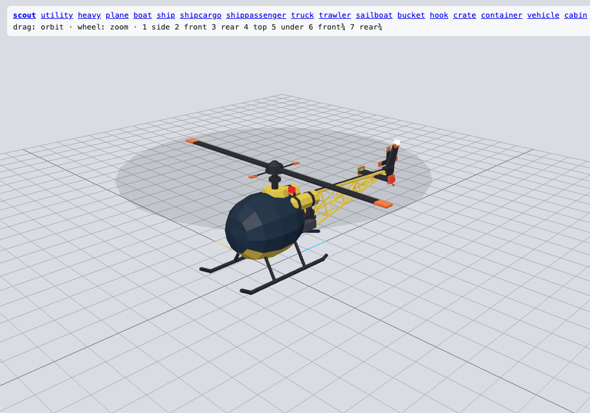<br>**Scout** (bucket) | 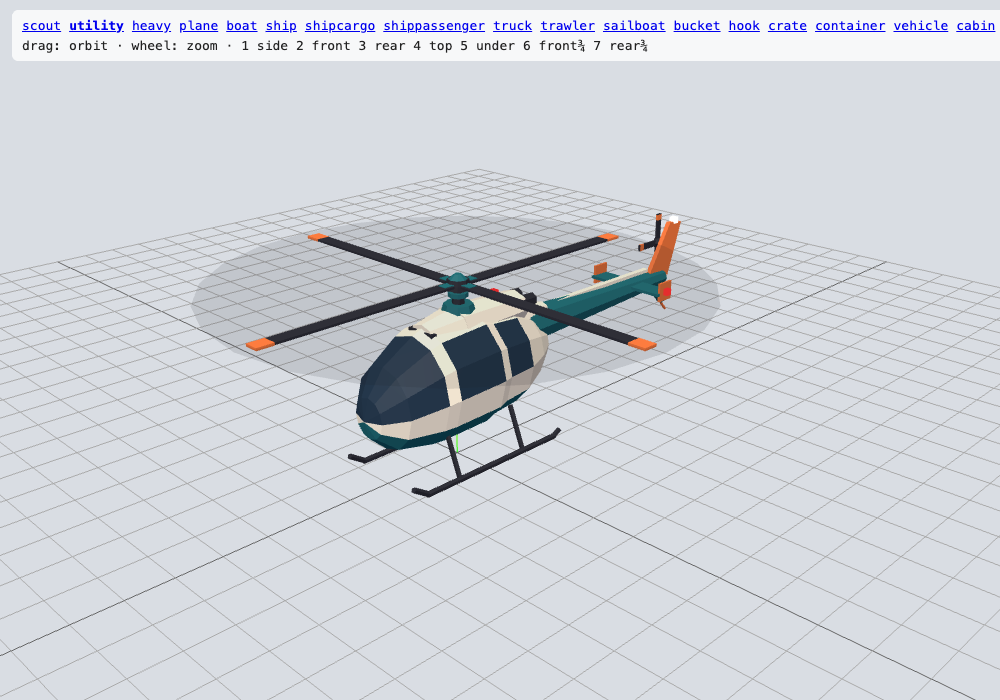<br>**Utility** (hook and winch) | 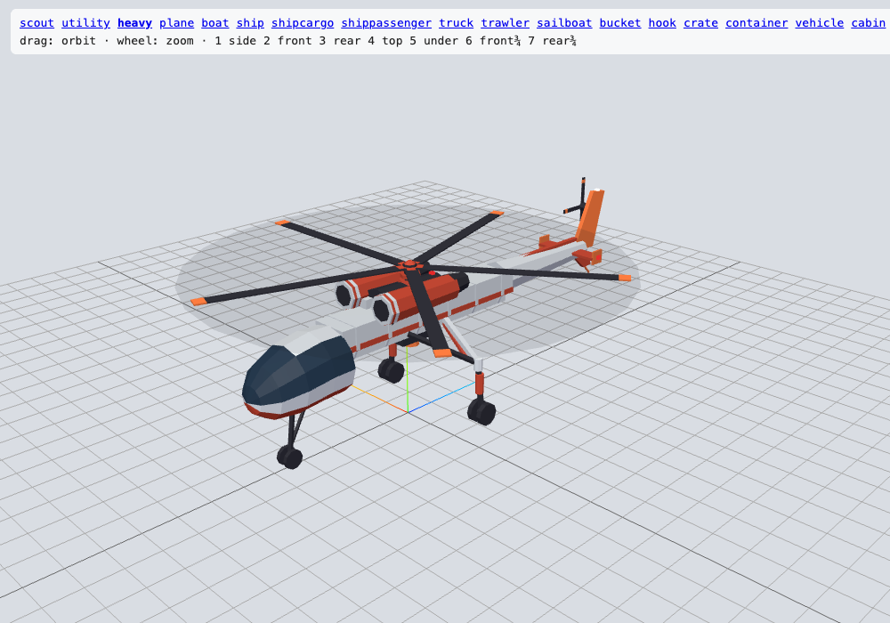<br>**Heavy Lifter** |
| 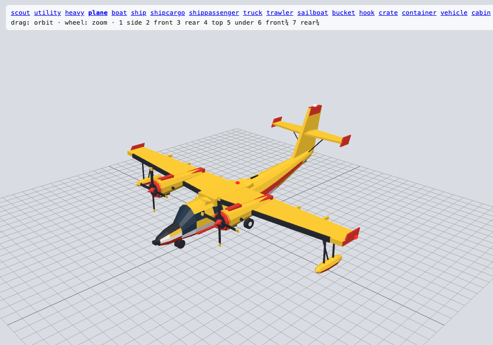<br>**Water Bomber** | 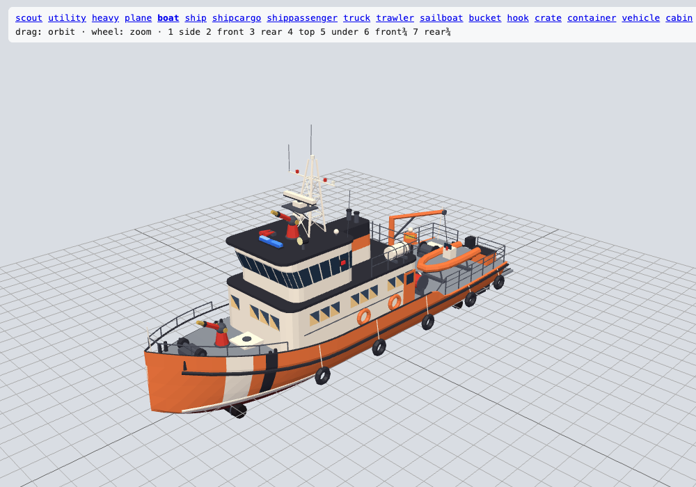<br>**Rescue Cutter** | |

## The world

Everything here is generated in code. View any model at `http://localhost:5173/inspect.html?model=<name>` while the dev server runs.

| | | |
|:-:|:-:|:-:|
| 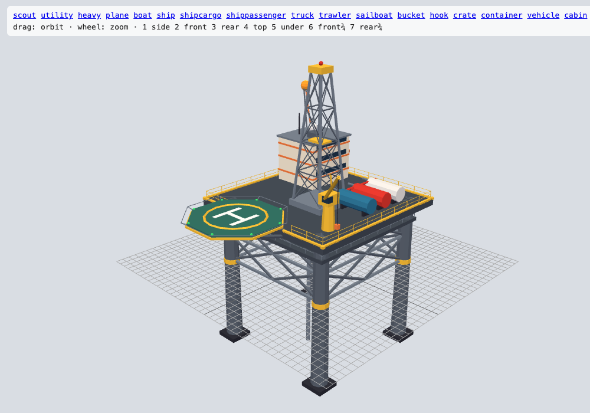<br>**Oil rig** | 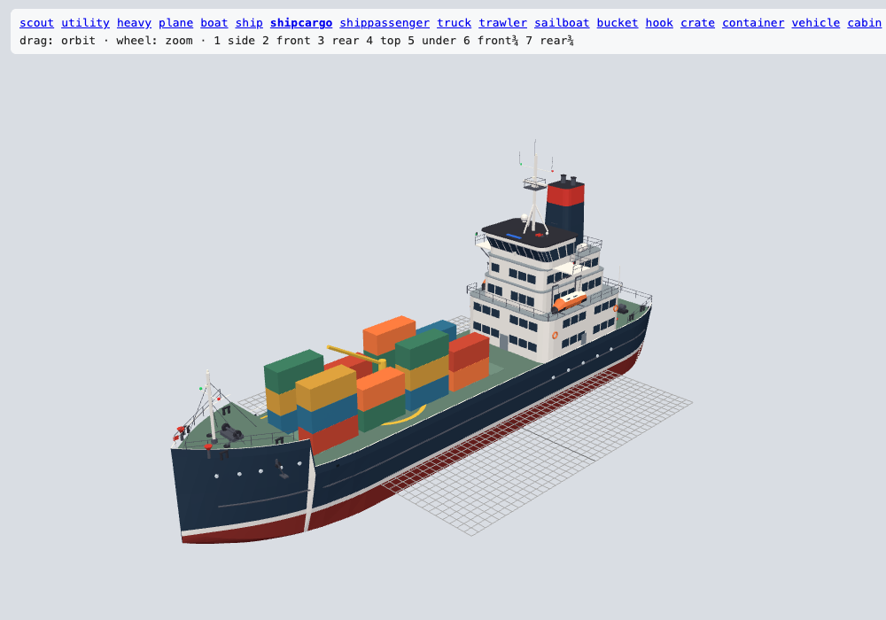<br>**Cargo ship** | 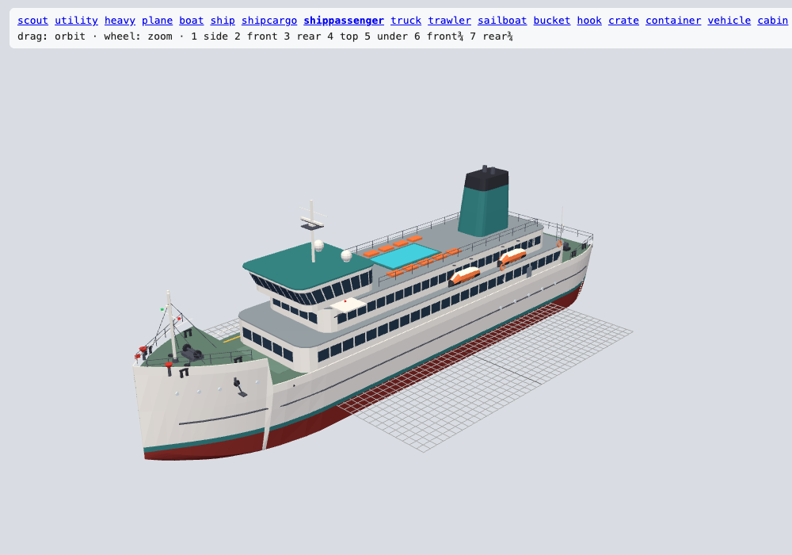<br>**Passenger ship** |
| 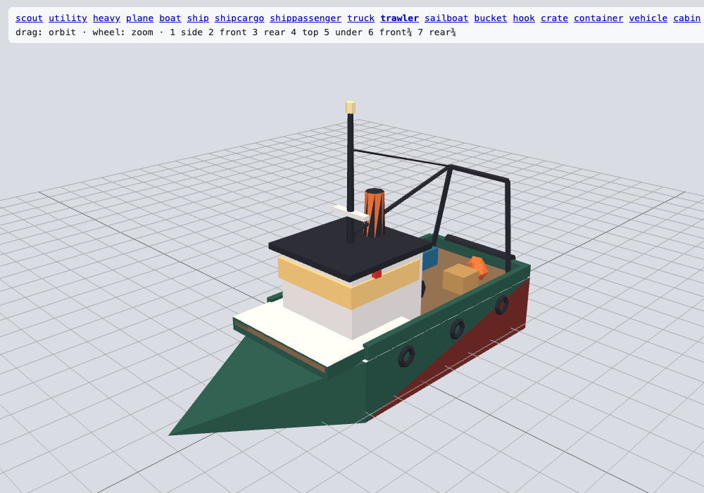<br>**Trawler** | 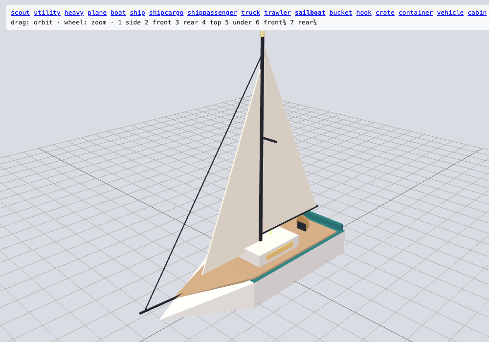<br>**Sailboat** | 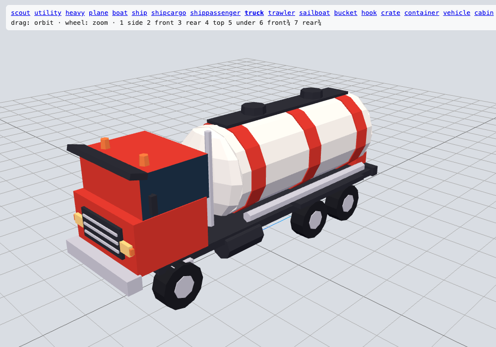<br>**Fuel truck** |

The freighter *MV Kestrel* steams round the island: land on her moving helideck to refuel, deliver cargo to her, or lift an injured sailor off.

## Quick start

Needs Node.js 18+.

```sh
npm install
npm run dev     # http://localhost:5173
npm test        # self-checks: flight, rig, fire, shift, career, costs, plane, firefight, physics, boat
npm run build   # static site in dist/
```

## Controls

**Helicopters:** W/S pitch · A/D turn · Q/E strafe · Space/Shift climb/descend · F action (dump / hook / release) · R bucket ↔ hook · Z/C winch in/out

**Water bomber:** Space/Shift throttle · W/S pitch (nose down/up) · A/D roll · Q/E rudder · F drop. Take off from the airstrip; skim the sea above ~65 km/h to scoop.

**Rescue Cutter:** W/S throttle ahead/astern · A/D wheel · drag the mouse to aim the fire monitors and searchlight · hold F to spray · G horn. Stop beside a casualty to pull them aboard; stop at the harbour jetty to refuel or open the hangar.

**Everywhere:** 1–5 take a call · X abandon the job · H hangar (title/results screen, the home pad or the airstrip) · mouse drag to look around · wheel to zoom · V cockpit/chase view · M mute · Esc pause

The minimap (bottom right) shows the island, fires, pads, calls, your objective and you.

In game the same list lives under **Settings** (main menu or pause), along with volume, look sensitivity, invert Y, FPS and an optional on-screen controls hint (off by default). Arrow keys also fly.

## Tokens spent

How much AI compute has gone into this game so far, across Claude Code and Antigravity (Gemini). Older Claude sessions were logged under the project's earlier names (*Rotor Relay*, `dispatch-game`) and are included.

<!-- tokens:start -->
| Model | Calls | Input | Cache write | Cache read | Output |
|---|--:|--:|--:|--:|--:|
| Gemini (Antigravity, all models) | 1,826 | 10,763,886 | 0 | 184,279,104 | 1,207,101 |
| claude-opus-5-5 | 886 | 1,864 | 3,081,089 | 303,800,171 | 1,134,719 |
| claude-sonnet-5-5 | 326 | 674 | 1,173,172 | 24,181,203 | 299,948 |
| claude-fable-5-2 | 129 | 276 | 745,708 | 38,516,817 | 228,325 |
| claude-haiku-5-5 | 6 | 12 | 87,341 | 233,539 | 5,202 |
| **Total** | 3,173 | 10,766,712 | 5,087,310 | 551,010,834 | **2,875,295** |

_Updated 2026-11-15 by `npm run tokens`. Cache read is the same context re-read each call, so it dominates; output is what the models wrote._
<!-- tokens:end -->

## Contributing

This is an AI-only project, so the rules differ from a usual open-source repo.

**The rule:** all code, assets-in-code, tests and docs must be written by AI agents. Pull requests containing hand-written code will be closed. Humans may:

- file issues and ideas (bugs, feel notes, "what if the game had...");
- write the prompts and steer the agent;
- review, play-test and merge.

**How to contribute**

1. Fork the repo and open it in your coding agent of choice (Claude Code, Gemini/Antigravity, Codex, Cursor, ...).
2. Point it at [`AGENTS.md`](AGENTS.md) first, then [`PLAN.md`](PLAN.md). They hold the stack rules, model conventions and every past design decision. Agents that skip them tend to repeat past mistakes.
3. Pick something: an open issue, a "Not done" item in `PLAN.md`, or your own idea.
4. Let the agent implement it on a branch, then check it:
   ```sh
   npm test          # must pass
   npm run build     # must succeed
   ```
5. **Models:** look at them in `inspect.html` from all seven views (keys 1-7), then fly them in game. Include screenshots in the PR.
6. Record any notable design decision in `PLAN.md` under the latest "Resolved decisions".
7. Open a PR with: what changed and why, which AI model/tool wrote it (new models get added to the list at the top), what you tested, and what you did *not* verify (play-feel, frame rate).

**Ground rules (the agents must follow these)**

- Three.js + Vite, plain JavaScript. **No new dependencies.**
- **Everything procedural.** No model or texture files; ask first about any asset and credit it below.
- **60 fps on an integrated GPU** is a hard requirement. Watch draw calls (about 20 in normal play) and triangle counts.
- **Keep it small** and match the surrounding style. No speculative abstractions.
- **Don't change flight or gameplay feel** unless the PR is about that.
- Low-poly, flat-shaded, warm-dusk look. See the model conventions in `AGENTS.md`.

**Good first experiments:** a new job type, a new aircraft, a cockpit interior, balance passes, new ambient life, multiplayer (a proposed shape is in `PLAN.md`).

## Credits

Everything is procedural (models, terrain, effects, most sound) except one recording:

- **Water bomber engine loop:** "airplane prop loop" by **AntumDeluge** ([OpenGameArt](https://opengameart.org/content/airplane-prop-loop)), edited from "Porter Prop plane Int.WAV" by **jakobthiesen** ([Freesound](https://freesound.org/s/188423/)). Both licensed [CC BY 3.0](https://creativecommons.org/licenses/by/3.0/). Converted to mono WAV, otherwise unmodified.
